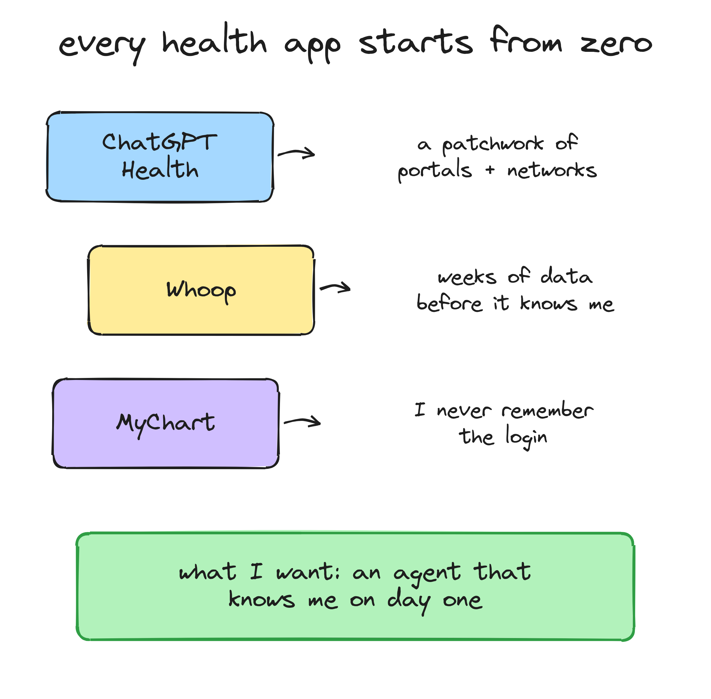
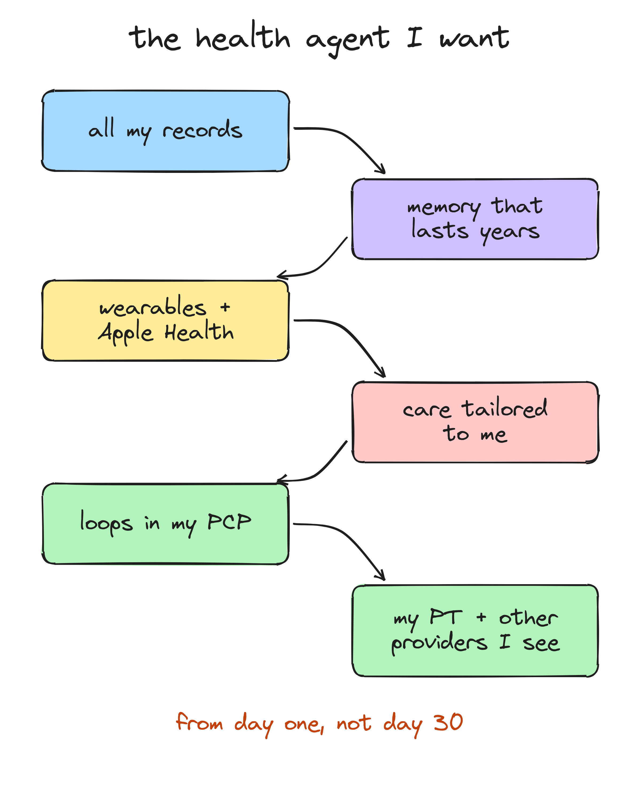
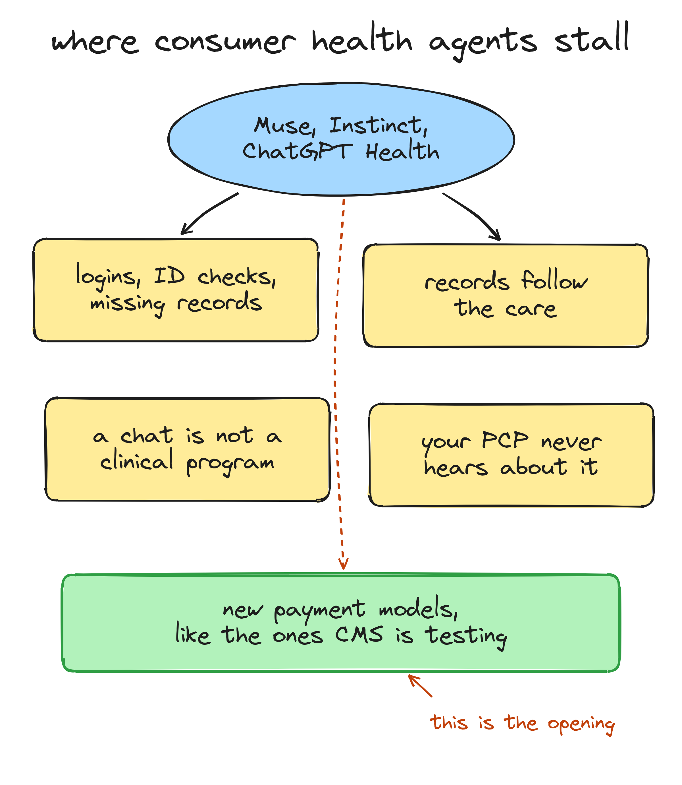
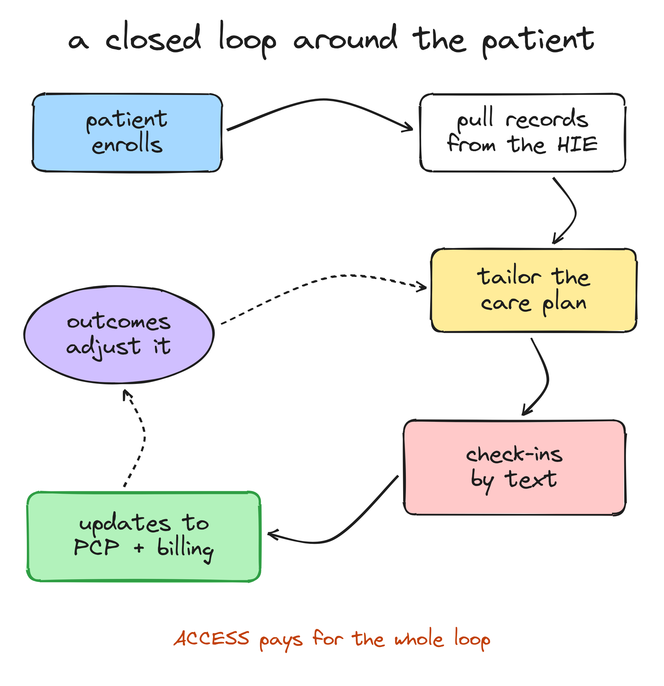

---
authors:
  - hjaveed
hide:
  - toc
date: 2026-10-13
readtime: 8
slug: personalized-health-agents
comments: true
---

# The Best Health Agent Won't Start From Zero

My dad bought something on Facebook Marketplace with Meta's Muse helping him through it. Other than ChatGPT voice, that was his first time using AI that actually does things for him. He called me afterwards and he was blown away.

That call stuck with me. For most people, Muse or something like it will be their first agent. And once you've had one, you start wanting it everywhere, including in your health. So this post is about what a personal health agent should look like, where the consumer agents get stuck, and why I think the real opening is new, innovative payment models, the kind CMS is now testing with [ACCESS](https://www.cms.gov/priorities/innovation/innovation-models/access){:target="\_blank"}.

<!-- more -->

## Muse will be most people's first agent

I wrote [last month](personal-agents-are-a-ux-innovation.md) about why Instinct and Muse are UX innovations. Since then I've become more convinced Meta will play a huge role here. Muse is [free for most of what people need](https://about.fb.com/news/2026/09/introducing-muse-personal-ai-agent/){:target="\_blank"}, and it lives inside WhatsApp. Meta doesn't have to convince anyone to download anything. It can put an agent in front of billions of people where they already chat with their family.

Most people haven't used agentic AI yet. Menlo Ventures found [41% of AI users have tried an agent](https://menlovc.com/perspective/2026-the-state-of-consumer-ai/){:target="\_blank"}, and that's AI users, not everyone. For the rest, like my dad, the first one will probably come through a messaging app. By 2027 I think this goes mainstream.

## Every health app I use starts from scratch

So what would a health agent need to be useful to me? I tried answering that from my own experience, and the honest answer is that everything I use starts from scratch.

- **ChatGPT Health** [pulls my records](https://help.openai.com/en/articles/20001036-health-in-chatgpt){:target="\_blank"} through [b.well](https://resources.icanbwell.com/openai-selects-bwell-to-power-secure-health-data-connectivity-for-ai-driven-health-experiences-in-chatgpt/){:target="\_blank"}, but it's still a patchwork of portals and networks.
- **Whoop** needs about [30 days](https://www.community.whoop.com/t/how-long-does-it-take-for-whoop-to-learn-your-baseline-metrics/359){:target="\_blank"} to learn my baseline.
- **MyChart** has a lot of my history, but I never remember the login.

The trend is clear though. People want an agent that understands them from the get-go. Here's the one I'd want.

## What I'd want under the hood

If I had to sketch the architecture, it's not that different from the personal agents I wrote about last month. The difference is what goes into memory and who's on the other end.

A few things I'd call out:

1. **Data in.** Historical records from HIEs and portals, claims, wearables, and the stuff you just tell it. Records give you the past, wearables give you today, and the conversation gives you everything else. Most products today pick one of these.
2. **Long-horizon memory.** Not a chat history. A timeline of your health: diagnoses, meds, what you tried, what worked, what you said you'd do and didn't. This is the part that makes it feel like it knows you. It should get better every month you use it, and it should never ask you something it already knows.
3. **The agent loop.** It plans, checks in, notices when something changes and adjusts. Same loop as any good personal agent, except a missed check-in is a signal here, not just a skipped task.
4. **Clinical programs and safety rules.** This is what separates a health agent from a chatbot that knows your labs. An evidence-based program for sleep, nutrition or back pain, plus rules for when to escalate to a human.
5. **Two outputs.** You, by text or voice. And your care team, your PCP and your PT, getting updates they can act on.

Honestly, the harness can be built. We have the models, the memory patterns and the agent loops. The hard part is getting the data in, and giving your PCP and other doctors a reason to be connected to the same app.

## So why can't Muse just do this?

Now here's the question I keep asking. Muse or Instinct could do a lot of this. For the sake of argument, treat them as frictionless consumer agents. I honestly don't see why people need a separate [MyFitnessPal app](https://x.com/thesamparr/status/2102811793844551818){:target="\_blank"} when Muse or Instinct can track meals for them. Sam Parr tracked calories in MyFitnessPal for years, and now calls Instinct the best tracker he's used: he texts a photo and it tells him what macros he has left. MyFitnessPal seems to see it too: they already [run inside ChatGPT](https://blog.myfitnesspal.com/myfitnesspal-chatgpt-your-nutrition-questions-answered-in-seconds/){:target="\_blank"}.

So where's the opportunity for healthcare companies? Consumer agents get stuck in two places: getting the data in, and actually delivering care.

**Getting the data in is still messy.** b.well is probably the closest thing to one front door today. It powers records in ChatGPT Health, and it [partnered with CLEAR](https://resources.icanbwell.com/bwell-connected-health-and-clear-target-portal-itis-with-strategic-partnership/){:target="\_blank"} so you can verify with your ID and a selfie instead of juggling portal logins. That's real progress. But OpenAI's own [help page](https://help.openai.com/en/articles/20001036-health-in-chatgpt){:target="\_blank"} still walks you through a sign-in for each provider and asks you to add missing information yourself. I haven't seen numbers on how many people make it through, and every extra step loses people. I've seen this firsthand with patients: a link that needs a login gets a fraction of the response of a simple text.

**Records follow the care.** Health systems and HIEs are built to share records with the providers treating you. A consumer app sits outside that path.

But let's say you crack the data part somehow. I think the bigger opportunity is what comes after.

**Knowing me isn't treating me.** Great, you know everything about me. Can you deliver a clinically relevant program for my nutrition, my sleep, my knee? That needs clinical design, protocols and someone accountable when it goes wrong.

**My doctor doesn't know any of this.** This is the biggest one. Even if Muse knows my whole life, my PCP doesn't. And there's no reason for them to look. A PCP has no time and no payment for reviewing what a consumer chatbot thinks about me. Without an incentive, the care team stays out of the loop.

## Medicare is where this works first

This is where I get excited. The opening is new, innovative payment models, and CMS is actively trying to build them through its [Innovation Center](https://www.cms.gov/priorities/innovation){:target="\_blank"}. One of them is the [ACCESS model](https://www.cms.gov/priorities/innovation/innovation-models/access){:target="\_blank"}. I want to be very clear about where I think the opportunity is right now.

For the average consumer, nobody has cracked who pays. [Function Health](https://www.functionhealth.com/){:target="\_blank"}, [Neko Health](https://techcrunch.com/2026/08/18/daniel-eks-body-scanning-startup-neko-health-opens-first-us-office-in-new-york/){:target="\_blank"} (the body-scan startup from Spotify's Daniel Ek) and [One Medical](https://www.onemedical.com/){:target="\_blank"} are great consumer-grade products, and they all run on cash or memberships. That works for people who already care about their health and can afford it. Getting a closed loop to everyone else is going to need more innovative payment models, and I don't think anyone has found them yet.

Baby boomers living with chronic illness are a different story. About [69% of people on traditional Medicare](https://mmshub.cms.gov/about-quality/types/multiple-chronic-care-conditions/overview){:target="\_blank"} have two or more chronic conditions. They need ongoing care far more than another dashboard. And for them, there's finally a payment model built for this.

[ACCESS](https://www.cms.gov/priorities/innovation/access-technical-frequently-asked-questions){:target="\_blank"}, the CMS model that started on July 5, pays tech-enabled care organizations to manage chronic conditions for people on traditional Medicare, and puts up to half of that payment at risk on outcomes. It also requires you to keep the patient's PCP updated: when care starts, when it ends, and at key clinical milestones. And it [pays the PCP](https://www.cms.gov/priorities/innovation/files/access-payments-amts-perf-targets.pdf){:target="\_blank"} a small co-management fee to stay in the loop. So the doctor finally has a reason to read the update.

That knocks down every wall from the last section:

- The patient enrolls with a provider organization, so pulling their records for treatment is legitimate.
- The program is clinical by design, with outcome targets you're paid on.
- The PCP gets structured updates, and gets paid to engage with them.
- Billing and outcome reporting come out of the same loop.

## What the loop looks like

Put together, the whole thing wraps around the patient.

This is what we're building at [RevelAI Health](https://www.revelaihealth.com/){:target="\_blank"} for the MSK track. I wrote about the [hard parts of getting patients into the program](cms-access-referrals.md) and the [infrastructure behind it](cms-access-infrastructure.md). The agent is the patient's side of it: one thread, records already loaded, a program that fits them, and a care team that actually hears about it.

## Why I'm excited

I think the future for personalized healthcare is awesome. Consumer agents like Muse are going to teach a billion people what it feels like to delegate to AI. That's great for healthcare, because it sets the bar. Patients will expect their health agent to know them, text them like a person and get things done.

But knowing someone isn't the same as caring for them. The companies that win in health will be the ones that close the loop: records in, a real program, and a care team that's in the loop and paid for it. For Medicare patients with chronic illness, that loop is funded today. For everyone else, I'm watching for the payment model that gets us there.

If you're building on ACCESS or another value-based model, I'd love to compare notes. And if you've tried a health agent that actually knew you from day one, tell me which one.
